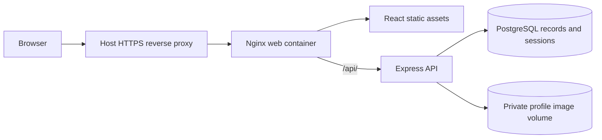

# Architecture

## System boundaries

Compose publishes web, API and database ports on loopback. The public HTTPS reverse proxy is host-managed and is not defined in `compose.yaml`. Nginx serves the SPA with history fallback and forwards `/api/` to `api:3000`. During development, Vite proxies API calls instead.

## Code map

| Location                                                         | Responsibility                                                      |
| ---------------------------------------------------------------- | ------------------------------------------------------------------- |
| `apps/web/src/App.tsx`                                           | Authentication bootstrap, first-password workflow and sign-out      |
| `apps/web/src/app/AppWorkspace.tsx`                              | Navigation, role-aware routes, dashboard and query provider         |
| `apps/web/src/features/employees/`                               | Directory, profile/PDS, departments, requests, leave and data tools |
| `apps/web/src/lib/`                                              | API calls, CSRF handling and public error presentation              |
| `apps/web/src/i18n/`                                             | Language state and translations                                     |
| `apps/api/src/app.ts`                                            | HTTP middleware, route registration and error handling              |
| `apps/api/src/auth/`                                             | Validation, session configuration, CSRF and access middleware       |
| `apps/api/src/routes/`                                           | API orchestration, transactions and endpoint authorization          |
| `apps/api/src/employees/`, `records/`, `spouse/`, `departments/` | Domain validation, field mappings and repositories                  |
| `apps/api/src/data/`                                             | Spreadsheet parsing, export and import validation                   |
| `apps/api/src/images/`, `audit/`                                 | Private image storage and audit recording                           |
| `apps/api/src/db/`                                               | SQL schema and reference seed                                       |

Although the database module exports a Drizzle instance, current domain queries primarily use parameterized SQL through `pg`. The shared workspace currently exports the application name; it is not a shared API schema library.

## Request lifecycle

Helmet and a configured-origin CORS policy run before body parsing. Health/readiness routes precede sessions. Other requests load a PostgreSQL-backed session; unsafe methods require a session CSRF token. Protected routes then resolve the user and current account status from the database, enforce role/first-login restrictions, validate input and execute the domain action. Errors pass through public-error protection and the final error handler.

The browser uses an HttpOnly session cookie and an in-memory CSRF token. Login regenerates the session. UI route visibility improves navigation, while the API independently enforces permission checks.

## Domain model and invariants

- Employees own the canonical profile and an immutable official employee ID. A user account links to an employee and carries a role, account status and password hash. Administrator scope and administered department are stored separately from the employee’s own department.
- Employment status and account status are separate. Inactive employee employment prevents employee access; status changes can revoke sessions.
- Departments support activation/deactivation. Spouse details are a single associated record; PDS sections are separate collections.
- Employees propose changes; administrator decisions apply validated changes and produce audit events. Preserve conflict checks when editing this flow.
- New leave records count inclusive dates excluding Fridays, Saturdays and configured public holidays. Holiday snapshots preserve stored record totals; corrections and cancellations require reasons. The day-off balance is calculated live from the joining date through today in Asia/Dhaka: each 11 eligible workdays earns one credit, and all non-cancelled leave types spend one credit per eligible day. Recorded leave days do not earn credit. Unused credits carry forward and negative balances are allowed. Future leave is shown separately; missing joining dates yield an unavailable balance. Calendar/joining-date changes recalculate balances, while historical stored leave totals remain unchanged.
- Profile image keys reference private files, not a public upload directory. Delivery checks personal ownership or scoped administrator access.
- File imports persist actor-bound previews with a 20-minute expiry and consumption state. Commit revalidates selected rows under a transaction. Preserve stale-data and replay protections.

Exports support CSV/XLSX; full PDS exports exclude photo binaries, passwords, leave and pending proposals. Sensitive fields are masked by default; self-export cannot request other employees or disable masking.

## Persistence and schema changes

`schema.sql` is applied by `npm run db:setup`; it is not a versioned migration framework. Review its exact SQL against an existing schema before deployment. `db:seed` supplies reference data; `auth:seed-admin` bootstraps a single administrator and refuses to replace an existing one. Never use initialization or demo-data scripts as routine deployment steps.

Database transactions couple record changes with audit events where implemented. Filesystem operations cannot participate in PostgreSQL transactions, so image storage and cleanup require special attention during failures and backups.

## Day-off balance endpoints

`GET /api/v1/me/day-off-balance` returns only the signed-in employee’s balance. `GET /api/v1/admin/day-off-balances` lists employees with `q`, `page` and `pageSize` filters. Balances include earned, taken, remaining, advance, workday progress and scheduled days. There is no stored balance or scheduled accrual job. Historical records are counted by their date ranges against the current holiday calendar rather than their old `day_count`.
